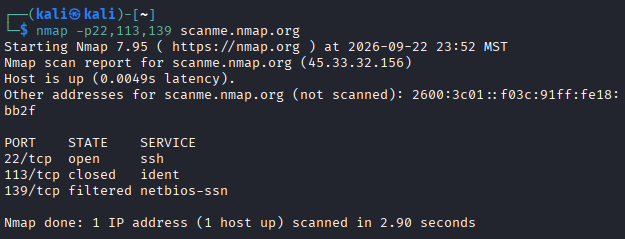
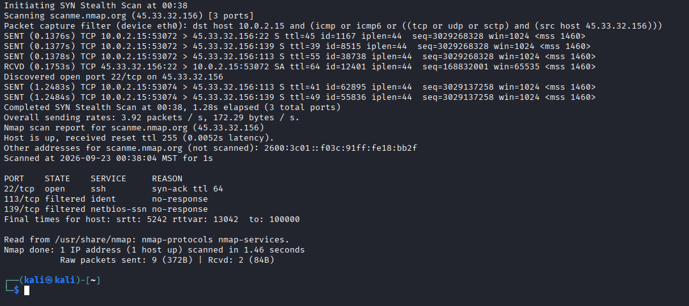
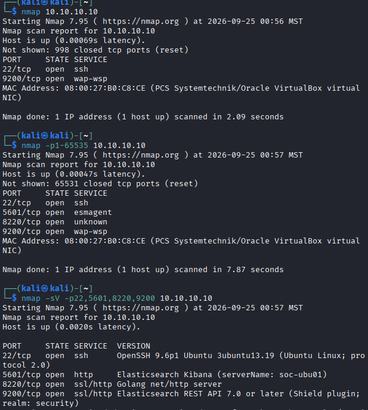
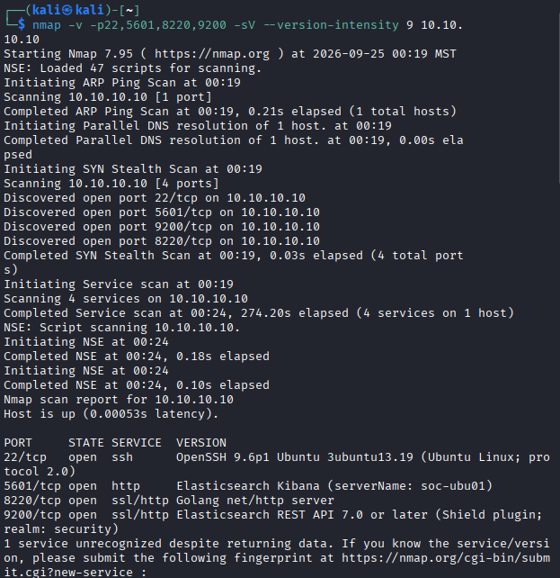

# Nmap Network Reconnaissance — TCP Port Discovery and Service Enumeration

## Executive Summary

This project documents network reconnaissance using Nmap to investigate TCP port states, packet-level scanning behavior, and exposed network services.

The investigation combined targeted scanning against Nmap's authorized public testing host with an independent assessment of a server in an isolated home lab.

The initial exercises focused on interpreting open, closed, and filtered TCP ports. The independent investigation extended this methodology through full-range TCP scanning and service/version detection.

The most significant finding occurred during the internal server assessment: a default Nmap scan identified two open TCP ports, while a full-range scan revealed four. Subsequent service enumeration identified applications including OpenSSH, Elasticsearch Kibana, and an Elasticsearch REST API.

The objective was to demonstrate systematic network reconnaissance, explain how TCP responses influence port-state classifications, and assess the limitations of relying on default scanning configurations.

## Investigation Scope

The investigation covered two authorized environments.

| Environment | Target | Investigation Focus |
| --- | --- | --- |
| Public testing host | `scanme.nmap.org` | Targeted TCP scanning and packet-level behavior |
| Isolated internal lab | `10.10.10.10` | Host discovery, full-range TCP scanning, and service/version enumeration |

### Internal Lab Environment

| Component | Configuration |
| --- | --- |
| Scanner | Kali Linux VM |
| Scanner IP | `10.10.10.20` |
| Target | `10.10.10.10` |
| Network | Isolated VirtualBox internal network |
| Primary tool | Nmap 7.95 |

The internal server was part of a controlled lab environment. Scanning was performed against infrastructure under my administration.

### Investigation Objectives

1. Identify open, closed, and filtered TCP ports using Nmap.
2. Examine the TCP probe and response behavior underlying port-state classification.
3. Determine whether an internal server is reachable.
4. Compare default TCP scanning with full-range port discovery.
5. Identify services and available version information on discovered ports.
6. Evaluate the security implications and limitations of reconnaissance results.

## Evidence Sources and Methodology

### Evidence Sources

The investigation used terminal output from Nmap scans performed in the authorized environments.

The analysis examined:

- TCP port states reported by Nmap.
- Packet-level SYN probes and responses.
- Target reachability.
- Differences between default and full-range scanning.
- Service names and version-detection results.
- Application-specific metadata returned during service enumeration.

### Investigation Methodology

| Phase | Analyst Activity |
| --- | --- |
| Targeted scanning | Scan selected TCP ports and interpret their reported states |
| Packet inspection | Use Nmap's packet-trace output to investigate TCP probes and responses |
| Baseline enumeration | Perform a default scan of the internal server |
| Expanded discovery | Scan the complete TCP port range to identify additional exposed services |
| Service identification | Apply service/version detection to discovered ports |
| Analysis | Compare results, explain exposed services, and document limitations |

### Evidence Standards

The investigation distinguishes direct Nmap observations from broader security conclusions.

An open TCP port indicates that the target responded in a manner consistent with a listening service. It does not independently demonstrate that the associated application is vulnerable.

A closed port indicates that Nmap received a response consistent with the absence of a listening service, while a filtered classification indicates that filtering or network conditions prevented a definitive open-or-closed determination.

Service/version detection can provide application information, but identified product names and versions remain subject to the accuracy and completeness of remote probing.

## Investigation Organization

The report documents four phases:

1. Targeted TCP Port Scanning
2. TCP SYN Packet Trace Analysis
3. Default vs. Full-Range TCP Port Discovery
4. Independent Service and Version Enumeration

The final sections consolidate the exposed-service findings, security implications, evidence limitations, skills demonstrated, and supporting screenshots.

## Investigation Findings

### Finding 1 — Targeted TCP Port Scanning

#### Investigation Context

The first investigation examined TCP port states using Nmap's authorized public testing host, `scanme.nmap.org`.

The objective was to identify differences between open, closed, and filtered TCP ports and understand what those classifications reveal about network accessibility.

#### Scan Results

The targeted scan returned three distinct TCP port states:

| Port | State | Analyst Interpretation |
| --- | --- | --- |
| `22/tcp` | `open` | A listening service was detected on TCP port 22 |
| `113/tcp` | `closed` | The target responded, but the port was not accepting connections |
| `139/tcp` | `filtered` | Nmap could not definitively determine whether the port was open or closed |



*Figure 1 — Targeted Nmap scan of the authorized testing host `scanme.nmap.org`, showing TCP/22 open, TCP/113 closed, and TCP/139 filtered.*

These classifications provide different levels of information about service accessibility.

An open port indicates that a service was reachable at the time of scanning. A closed port indicates that the target was reachable but did not have a listener accepting connections on the tested port. A filtered classification indicates that a firewall, network device, or filtering condition prevented Nmap from determining the port's state.

#### Security Relevance

Identifying open TCP ports helps analysts understand which network services are exposed to a particular scanning location.

Open ports may require further investigation to determine whether the associated services are necessary, correctly configured, and appropriately restricted.

Closed and filtered ports provide additional context about network accessibility and the possible presence of security controls.

However, port-state results alone do not establish that a system is vulnerable or that its network controls are effective.

#### Analyst Assessment

**Assessment: Three TCP port states successfully identified and interpreted.**

The targeted scan distinguished open, closed, and filtered ports on the authorized testing host.

This established a baseline for understanding how Nmap classifies network accessibility before examining the underlying packet exchanges in Finding 2.

### Finding 2 — TCP SYN Packet Trace Analysis

#### Investigation Context

The second investigation examined Nmap's TCP SYN scanning behavior using packet tracing.

The objective was to understand how Nmap sends probes, interprets target responses, and determines whether a TCP port is open, closed, or filtered.

#### Packet Trace Analysis

The scan targeted `scanme.nmap.org` (`45.33.32.156`) from a Kali Linux system using source IP `10.0.2.15`.

Nmap performed a SYN stealth scan against TCP ports `22`, `113`, and `139`.

The packet trace displayed outbound SYN packets targeting all three ports. A SYN-ACK response was received from TCP port `22`, while no responses were recorded for ports `113` and `139` in the displayed trace.

| Port | Observed Response | Nmap Classification |
| --- | --- | --- |
| `22/tcp` | SYN-ACK received | `open` |
| `113/tcp` | No response | `filtered` |
| `139/tcp` | No response | `filtered` |



*Figure 2 — Nmap SYN packet trace against scanme.nmap.org showing outbound SYN probes, a SYN-ACK response from TCP port 22, and no responses from ports 113 and 139. The results classify port 22 as open and ports 113 and 139 as filtered.*

The trace explicitly reported `syn-ack` as the reason for port `22` being open and `no-response` for ports `113` and `139` being filtered.

Nmap reported nine raw packets sent and two received during the scan.

#### TCP SYN Scanning Interpretation

A TCP SYN scan attempts to determine port availability without completing the normal three-way handshake for every tested port.

Typical responses include:

| Response | Interpretation |
| --- | --- |
| SYN-ACK | Indicates an open TCP port |
| RST | Indicates a closed TCP port |
| No response after retransmission | May result in a filtered classification |
| Certain ICMP unreachable responses | May also indicate filtering |

This behavior allows Nmap to identify accessible services and distinguish some network filtering conditions.

In this capture, TCP port `22` responded with SYN-ACK, while the other tested ports did not provide responses sufficient to classify them as open or closed.

#### Security Relevance

Packet-level scan analysis provides additional context beyond a final list of open ports.

For example, repeated unanswered probes may indicate network filtering, packet loss, or other connectivity conditions. A SYN-ACK response demonstrates that a target port responded as open from the scanner's network position.

Understanding these differences helps analysts avoid treating every unreachable or filtered port as definitively closed.

#### Analyst Assessment

**Assessment: TCP SYN scanning behavior and response-based port classification identified.**

The packet trace demonstrated how Nmap uses SYN probes and responses to classify TCP port states.

The results also showed that scan observations can vary between attempts. The earlier targeted scan classified port `113` as closed, whereas this trace reported it as filtered.

The available evidence does not establish why that classification changed.

### Finding 3 — Default vs. Full-Range TCP Port Discovery

#### Investigation Context

The third investigation assessed how scan scope affects service discovery on an internal Linux server.

The objective was to compare Nmap's default TCP port selection against a scan covering all 65,535 TCP ports.

The target was `10.10.10.10`, a server in my isolated VirtualBox lab environment.

#### Default TCP Scan

I began with a default Nmap scan:

```bash
nmap 10.10.10.10
```

The scan identified two open ports:

| Port | State | Nmap Service Label |
| --- | --- | --- |
| `22/tcp` | `open` | `ssh` |
| `9200/tcp` | `open` | `wap-wsp` |

Nmap also reported 998 closed TCP ports.

These results represented the exposed ports identified by Nmap's default scan selection, not an exhaustive assessment of every TCP port.

The `wap-wsp` label was Nmap's initial port-based service identification and did not establish the actual application listening on TCP port `9200`.

#### Full-Range TCP Scan

I expanded the assessment to all TCP ports:

```bash
nmap -p1-65535 10.10.10.10
```

The expanded scan returned:

| Port | State | Nmap Service Label |
| --- | --- | --- |
| `22/tcp` | `open` | `ssh` |
| `5601/tcp` | `open` | `esmagent` |
| `8220/tcp` | `open` | `unknown` |
| `9200/tcp` | `open` | `wap-wsp` |

Nmap reported 65,531 closed ports in this scan.

Compared with the default scan, the expanded scan discovered two additional open ports:

- `5601/tcp`
- `8220/tcp`

This demonstrated that relying exclusively on the default port selection could produce an incomplete view of a target's accessible services.

#### Scan Comparison

| Measurement | Default Scan | Full-Range Scan |
| --- | --- | --- |
| TCP ports scanned | 1,000 | 65,535 |
| Open ports discovered | 2 | 4 |
| Closed ports reported | 998 | 65,531 |
| Open TCP ports | `22`, `9200` | `22`, `5601`, `8220`, `9200` |
| Reported scan duration | 2.09 seconds | 7.87 seconds |



*Figure 3 — Comparison of a default Nmap scan and a full-range TCP scan against `10.10.10.10`. The default scan identified ports 22 and 9200, while the expanded scan additionally identified ports 5601 and 8220. The screenshot also includes subsequent service-detection output.*

The full-range scan identified twice as many open ports as the default scan in this lab.

The difference arose from examining a broader range of TCP ports rather than limiting the assessment to Nmap's default selection.

#### Security Relevance

Incomplete port discovery can cause analysts to overlook network-accessible services.

In this investigation, the additional ports were associated with services in a security monitoring environment. Their visibility is relevant to understanding which components can be reached from the scanner's network location.

However, an open port does not independently establish that a service is vulnerable or accessible from outside the isolated lab network.

#### Analyst Assessment

**Assessment: Full-range TCP scanning identified additional open services not reported by the default scan.**

The initial scan identified ports `22` and `9200`, while the expanded scan also discovered `5601` and `8220`.

This investigation demonstrated how scan configuration directly affects the completeness of network reconnaissance results.

### Finding 4 — Independent Service and Version Enumeration

#### Investigation Context

The final investigation extended port discovery into service and version enumeration against my isolated internal lab server at `10.10.10.10`.

After identifying four open TCP ports, I used Nmap's service-detection capabilities to investigate the applications and protocols associated with those ports.

The objective was to distinguish initial port-based service labels from application information obtained through active service probing.

#### Service Detection Command

I performed an explicit service/version scan against the four discovered ports:

```bash
nmap -v -p22,5601,8220,9200 -sV --version-intensity 9 10.10.10.10
```

The scan used:

- `-v` to display verbose progress information.
- `-p22,5601,8220,9200` to limit scanning to the four previously discovered open ports.
- `-sV` to enable service and version detection.
- `--version-intensity 9` to use the highest service-probe intensity.

#### Service Enumeration Results

Nmap 7.95 reported the target as reachable and identified four open TCP ports.

| Port | State | Service | Nmap Version/Fingerprint Information |
| --- | --- | --- | --- |
| `22/tcp` | `open` | `ssh` | OpenSSH 9.6p1 Ubuntu 3ubuntu13.19 |
| `5601/tcp` | `open` | `http` | Elasticsearch Kibana, server name `soc-ubu01` |
| `8220/tcp` | `open` | `ssl/http` | Golang `net/http` server |
| `9200/tcp` | `open` | `ssl/http` | Elasticsearch REST API 7.0 or later, with security-realm metadata |



*Figure 4 — Independent Nmap service/version scan of `10.10.10.10`, identifying OpenSSH, Elasticsearch Kibana, a Golang HTTP server, and Elasticsearch REST API fingerprints across four open TCP ports.*

The results provided substantially more application context than the initial default scan.

For example, the default scan associated TCP port `9200` with the generic service label `wap-wsp`, while active service detection identified behavior consistent with an Elasticsearch REST API.

The scan also identified Kibana on port `5601` and a Golang HTTP service on port `8220`.

The presence of a Golang HTTP service does not independently establish the application's precise identity. Additional validation would be needed to confirm the service implementation and configuration.

#### Service Fingerprint Limitations

Nmap reported that one service remained unrecognized despite returning data.

This highlights an important limitation of remote service enumeration: active probing can identify protocol behavior, application fingerprints, and potential version information without conclusively identifying every application.

The reported OpenSSH version and Elasticsearch version range were observations from Nmap's output, not independently verified software inventory records.

#### Security Relevance

Service enumeration provides additional context for assessing network-accessible infrastructure.

Identifying exposed SSH, HTTP, and HTTPS services allows an analyst to determine which applications may warrant configuration review, access-control validation, and vulnerability assessment.

For a security monitoring server, management interfaces and telemetry-related services are particularly important because unauthorized access could affect security visibility or the confidentiality and integrity of collected data.

However, the scan was conducted within an isolated lab network. It did not establish that these services were publicly accessible or exploitable.

No exploitation or vulnerability verification was performed as part of this investigation.

#### Analyst Assessment

**Assessment: Four open TCP ports enumerated, with service fingerprints providing additional application context.**

The investigation demonstrated how service/version detection improves on basic port discovery by collecting application-level information.

The analysis also distinguished Nmap's reported fingerprints from confirmed software inventory and avoided treating exposed services as automatically vulnerable.