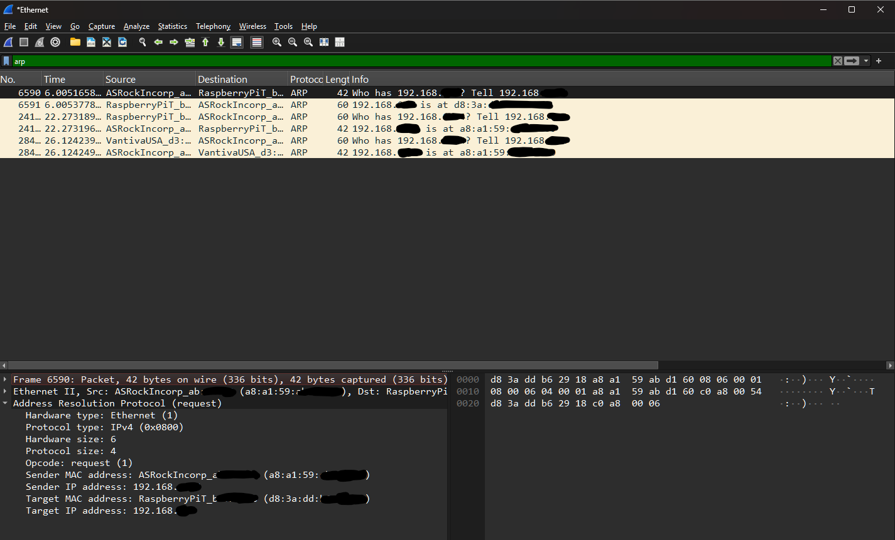
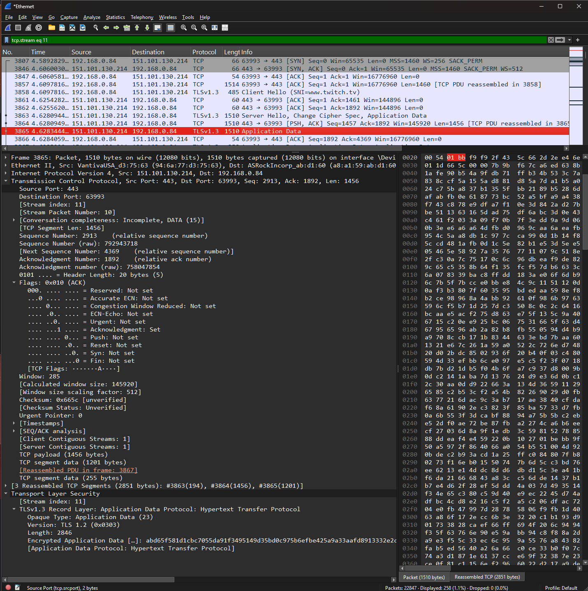

# Wireshark Traffic Analysis — Network Protocol Investigation

## Executive Summary

This project documents hands-on network traffic analysis using Wireshark to investigate TCP connections, DNS resolution, HTTP communication, and TLS negotiation.

The investigation focused on interpreting packet-level evidence to understand how network communication is established, how applications identify remote destinations, and what information is visible during encrypted and unencrypted traffic.

The analysis covered four protocol areas:

- **TCP:** Connection establishment using the SYN, SYN-ACK, and ACK handshake.
- **DNS:** Domain-name resolution and interpretation of query and response traffic.
- **HTTP:** Application-layer requests and observable protocol metadata.
- **TLS:** Client Hello messages and the negotiation process used to establish encrypted connections.

The objective was to develop practical packet-analysis skills relevant to SOC monitoring, network troubleshooting, and security investigations.

## Investigation Scope

The investigation used Wireshark packet captures collected in a controlled lab environment.

| Protocol | Investigation Focus | Security Relevance |
| --- | --- | --- |
| TCP | Three-way handshake and connection establishment | Identifying successful connections and unusual connection patterns |
| DNS | Domain queries and responses | Investigating suspicious destinations and DNS activity |
| HTTP | Request methods, headers, and response behavior | Examining application communication and unencrypted traffic |
| TLS | Client Hello and handshake metadata | Understanding visibility and limitations of encrypted traffic |

### Investigation Objectives

1. Identify the protocols present in captured network traffic.
2. Examine TCP flags and the sequence used to establish connections.
3. Analyze DNS queries and responses associated with domain resolution.
4. Interpret visible HTTP request and response information.
5. Identify key fields in the TLS handshake.
6. Explain what network traffic reveals and what cannot be concluded from the available packets.

## Evidence Sources and Methodology

### Evidence Sources

Wireshark was used to inspect captured packets and analyze protocol-specific fields.

The investigation emphasized:

- Source and destination IP addresses
- Source and destination ports
- TCP flags and connection sequences
- DNS query names and response information
- HTTP request and response fields
- TLS handshake messages and visible negotiation metadata

### Investigation Methodology

| Step | Analyst Activity |
| --- | --- |
| Capture | Collect network packets in the authorized lab environment |
| Filter | Isolate relevant protocols and conversations |
| Inspect | Examine packet headers, flags, and protocol fields |
| Correlate | Connect related packets to reconstruct communication sequences |
| Assess | Explain the observed behavior and its security relevance |
| Document | Preserve screenshots and evidence-based conclusions |

### Evidence Standards

The analysis distinguishes protocol observations from broader security conclusions.

For example, a TCP handshake demonstrates connection establishment but does not independently establish that an application successfully completed its intended operation.

A DNS query does not prove that a subsequent connection was made to the resolved destination.

Similarly, observing a TLS Client Hello demonstrates an attempt to negotiate encrypted communication, not necessarily that the handshake completed successfully.

## Investigation Organization

The report documents four protocol investigations:

1. TCP Connection Establishment
2. DNS Query and Response Analysis
3. HTTP Traffic Inspection
4. TLS Handshake Analysis

The final sections will consolidate security implications, evidence limitations, and skills demonstrated.

## Investigation Findings

### Finding 1 — TCP Three-Way Handshake

#### Investigation Context

The first investigation focused on identifying how a TCP connection is established between two endpoints.

Using Wireshark, I examined the initial packets of a TCP conversation to identify the handshake sequence and interpret the flags associated with connection establishment.

#### Packet Analysis

A successful TCP three-way handshake consists of three packets:

| Sequence | TCP Flags | Interpretation |
| --- | --- | --- |
| 1 | `SYN` | The client initiates a connection |
| 2 | `SYN, ACK` | The server acknowledges the request and responds |
| 3 | `ACK` | The client acknowledges the server's response |

#### Observed TCP Connection

The Wireshark capture identified a connection from `192.168.0.84:60144` to `151.101.194.214:443`.

The following packets established the connection:

| Frame | Source | Destination | TCP Flags |
| --- | --- | --- | --- |
| `9160` | `192.168.0.84:60144` | `151.101.194.214:443` | `SYN` |
| `9202` | `151.101.194.214:443` | `192.168.0.84:60144` | `SYN, ACK` |
| `9203` | `192.168.0.84:60144` | `151.101.194.214:443` | `ACK` |

*Figure 1 — Wireshark TCP stream 10 showing the SYN, SYN-ACK, and ACK handshake between `192.168.0.84:60144` and `151.101.194.214:443`. The selected SYN packet displays TCP flag `0x002`.*

The sequence confirmed successful TCP connection establishment.

Subsequent packets included a TLS Client Hello and encrypted application data, indicating that the connection proceeded beyond the TCP handshake into TLS communication.

The observed packets did not independently establish the legitimacy of the remote service or the application-level purpose of the connection.

The investigation examined packet direction, TCP flags, source and destination ports, and sequence information to distinguish the handshake stages.

The observed packet sequence was consistent with successful TCP connection establishment.

#### Security Relevance

TCP handshake analysis is useful for distinguishing established connections from incomplete connection attempts.

For example, repeated SYN packets without corresponding SYN-ACK responses can indicate connection failures, filtering, or potentially suspicious scanning behavior, depending on the broader context.

However, an established TCP connection does not independently prove that higher-layer application communication succeeded or that the connection was malicious.

#### Analyst Assessment

**Assessment: TCP connection establishment identified through the three-way handshake.**

The packet sequence demonstrated how TCP synchronization and acknowledgment flags establish a connection.

The investigation also showed how packet-level analysis can support network troubleshooting and SOC investigations by identifying whether the initial connection process completed.

### Finding 2 — DNS Query and Response Analysis

#### Investigation Context

The second investigation examined Domain Name System (DNS) traffic using Wireshark.

DNS translates domain names into information such as IP addresses, allowing clients to locate network services without relying on manually entered addresses.

The objective was to identify DNS requests, examine the corresponding responses, and determine what information was visible in the captured traffic.

#### Packet Analysis

Using the Wireshark display filter `dns`, I isolated DNS packets and examined communication between the client and DNS server.

The captured traffic included the following observations:

| Field | Observed Value |
| --- | --- |
| Client IP | `192.168.0.84` |
| DNS server IP | `192.168.0.6` |
| Client UDP port | `62122` |
| DNS destination port | `53` |
| Queried domain | `example.com` |
| Query type | `A` |
| Query transaction ID | `0x0002` |
| Query frame | `2095` |
| Response frame | `2096` |

*Figure 2 — Wireshark DNS capture showing a UDP query for `example.com` from `192.168.0.84` to `192.168.0.6`, with frame 2095 linked to response frame 2096.*

Frame `2095` contained a standard DNS query requesting an IPv4 address record for `example.com`.

Frame `2096` contained the corresponding response, identified by the matching transaction ID `0x0002`.

The DNS response included two IPv4 addresses:

- `172.66.147.243`
- `104.20.23.154`

The capture also contained AAAA queries for IPv6 records, PTR reverse-lookup queries, and DNS activity involving `v20.events.data.microsoft.com`.

#### Query and Response Correlation

The relationship between frames `2095` and `2096` demonstrated how a client request can be matched to its corresponding DNS response.

The client sent its query to UDP destination port `53`, and the DNS server returned address information for the requested domain.

The query and response shared a transaction identifier, providing an additional correlation field beyond source and destination addresses.

#### Security Relevance

DNS analysis is useful for identifying external destinations and investigating suspicious name-resolution behavior.

For example, unusual domains, repeated queries, unexpected record types, or excessive failed resolutions can warrant further investigation when correlated with endpoint and network activity.

However, a successful DNS response does not independently establish that the client subsequently connected to the returned IP addresses.

#### Analyst Assessment

**Assessment: DNS name resolution and query-response correlation successfully identified.**

The packet evidence demonstrated how DNS requests and responses can be reconstructed using Wireshark.

The investigation also showed how DNS telemetry can provide useful destination context while remaining distinct from evidence of subsequent network connections.

### Finding 3 — HTTPS and TLS Encrypted Traffic Analysis

#### Investigation Context

The third investigation examined HTTPS communication using Wireshark, focusing on the TLS handshake and encrypted application data.

The objective was to distinguish information visible during TLS negotiation from application content protected by encryption.

#### Packet Analysis

Using the Wireshark display filter `tcp.port == 443`, I isolated TCP traffic involving HTTPS connections.

The capture showed communication between `192.168.0.84` and `23.211.177.8` over TCP port `443`.

The following TLS handshake messages were observed:

| Frame | TLS Message | Interpretation |
| --- | --- | --- |
| `2651` | Client Hello | Client initiates TLS negotiation |
| `2678` | Server Hello | Server responds with negotiated parameters |
| `2683` | Certificate Status, Server Key Exchange, Server Hello Done | Additional server-side handshake messages |
| `2685` | Client Key Exchange, Change Cipher Spec, Encrypted Handshake Message | Client proceeds with key exchange and encrypted handshake |
| `2703` | New Session Ticket, Change Cipher Spec, Encrypted Handshake Message | Server continues handshake completion |
| `2705` | Application Data | Encrypted application communication follows |

*Figure 3 — Wireshark capture showing TLS negotiation with `catalog.gamepass.com` visible in the Client Hello SNI, followed by encrypted application data. Frame 2721 displays a TLS 1.2 application-data record.*

The Client Hello also exposed a Server Name Indication (SNI) value:

`catalog.gamepass.com`

This demonstrated that destination hostname information was visible in the captured Client Hello.

The capture subsequently showed encrypted application data exchanged between the endpoints.

#### Encrypted Application Data

Frame `2721` contained a TLS application-data record sent from `23.211.177.8:443` to `192.168.0.84:61947`.

The selected packet displayed:

- TLS version field: `TLS 1.2`
- Record content type: `Application Data (23)`
- Encrypted application-data bytes
- Application protocol identified by Wireshark as HTTP/2

Because the application payload was encrypted, the screenshot did not expose plaintext HTTP requests, response bodies, or application content.

#### Security Relevance

TLS analysis allows security analysts to examine network metadata even when application payloads are encrypted.

Observable information can include source and destination addresses, ports, packet direction, handshake messages, and some negotiation metadata.

However, encrypted application data limits direct inspection of application-layer content without appropriate decryption capabilities.

#### Analyst Assessment

**Assessment: TLS negotiation and subsequent encrypted application communication identified.**

The observed handshake sequence and subsequent application-data records were consistent with an established encrypted connection.

The evidence demonstrated the distinction between visible network metadata and encrypted application content.

No conclusion about malicious activity was supported by this packet capture alone.

### Finding 4 — ARP Request and Response Analysis

#### Investigation Context

The fourth investigation examined Address Resolution Protocol (ARP) traffic to understand how devices discover the MAC addresses associated with IPv4 addresses on a local network.

Unlike DNS, which resolves domain names into records such as IP addresses, ARP supports local network delivery by associating an IPv4 address with a link-layer hardware address.

The objective was to distinguish ARP requests from replies and identify the information exposed during local address resolution.

#### Packet Analysis

Using the Wireshark display filter `arp`, I isolated ARP traffic and examined the packet list and protocol details.

The capture showed communication involving devices identified by Wireshark as ASRockInc or ASRockIncorp, RaspberryPi, and VantivaUSA.

| Evidence | Observation |
| --- | --- |
| Display filter | `arp` |
| Selected frame | `6590` |
| Selected packet size | 42 bytes |
| Protocol | ARP over Ethernet/IPv4 |
| Hardware type | Ethernet (1) |
| Protocol type | IPv4 (`0x0800`) |
| Hardware address size | 6 bytes |
| Protocol address size | 4 bytes |
| Selected packet opcode | Request (1) |

*Figure 4 — Wireshark capture filtered for ARP traffic. Frame 6590 displays an Ethernet/IPv4 ARP request, followed by frame 6591 showing an ARP reply. Additional local address-resolution exchanges are visible.*

Frame `6590` contained an ARP request from an ASRock-associated device asking for the hardware address corresponding to a local `192.168.x.x` IPv4 address.

The following frame, `6591`, displayed an ARP reply from a Raspberry Pi-associated device containing an IP-to-MAC address association.

Additional request and reply traffic was visible between ASRock-associated, Raspberry Pi-associated, and Vantiva-associated devices.

Some portions of the addresses were intentionally redacted in the screenshot.

#### Request and Reply Interpretation

An ARP request asks which device owns a particular IPv4 address on the local network.

An ARP reply provides the corresponding hardware address, allowing the requesting host to direct Ethernet frames to the appropriate destination.

The captured packets demonstrated both request and reply behavior, showing how hosts maintain the address mappings required for local communication.

The visible packet sequence was consistent with ordinary ARP address resolution.

#### Security Relevance

ARP traffic can be useful when investigating local network connectivity problems, unexpected address changes, and potential ARP spoofing activity.

For example, conflicting MAC address mappings for the same IPv4 address may warrant additional investigation.

However, the presence of ordinary ARP requests and replies does not establish ARP spoofing or malicious activity.

#### Analyst Assessment

**Assessment: ARP requests and replies identified in local network traffic.**

The capture demonstrated how Wireshark exposes hardware addresses, protocol identifiers, and address-resolution behavior.

No malicious ARP activity was established by the available screenshot.

### Finding 5 — Independent TCP/TLS Connection Investigation

#### Investigation Context

To extend the guided packet-analysis exercises, I independently selected and investigated a TCP conversation in Wireshark.

The objective was to reconstruct the connection from its initial TCP handshake through TLS negotiation and encrypted application communication.

Rather than examining isolated protocol packets, this investigation correlated multiple stages of a single network conversation.

#### Connection Identification

I applied the Wireshark display filter `tcp.stream eq 11` to isolate the selected conversation.

| Field | Observed Value |
| --- | --- |
| Client IP | `192.168.0.84` |
| Remote IP | `151.101.130.214` |
| Client source port | `63993` |
| Server destination port | `443` |
| TCP stream | `11` |
| TLS Client Hello SNI | `www.twitch.tv` |
| TLS protocol identified by Wireshark | TLS 1.3 |

#### Packet Sequence Reconstruction

The captured sequence included the following events:

| Frame | Direction | Observation |
| --- | --- | --- |
| `3807` | Client → Server | TCP SYN |
| `3846` | Server → Client | TCP SYN, ACK |
| `3847` | Client → Server | TCP ACK |
| `3858` | Client → Server | TLS Client Hello |
| `3863` | Server → Client | TLS Server Hello, Change Cipher Spec, Application Data |
| `3865` | Server → Client | TLS Application Data |

*Figure 5 — Independent Wireshark investigation of TCP stream 11 showing connection establishment, TLS negotiation, visible SNI for www.twitch.tv, and encrypted TLS application data.*

The first three packets confirmed that the TCP connection was established.

Following connection establishment, the client initiated TLS negotiation. The Client Hello exposed the server name `www.twitch.tv`.

The subsequent Server Hello and encrypted application-data records demonstrated progression into TLS-protected communication.

#### Encrypted Traffic Examination

Frame `3865` contained TLS application data sent from `151.101.130.214:443` to `192.168.0.84:63993`.

Wireshark displayed the traffic as TLS 1.3 and identified an encrypted application-data record.

Although the TLS record-layer version field displayed `0x0303` (TLS 1.2), this is a legacy compatibility field and does not establish that the negotiated connection used TLS 1.2.

The visible evidence did not reveal plaintext application requests or response content.

#### Security Relevance

Reconstructing an entire network conversation is useful during SOC investigations because it allows analysts to distinguish:

- TCP connection establishment from incomplete connection attempts.
- TLS negotiation from application-data transfer.
- Observable destination metadata from encrypted content.
- Confirmed packet behavior from assumptions about the application.

The connection to TCP port `443` and the visible SNI provided destination context, but neither established malicious activity.

#### Analyst Assessment

**Assessment: TCP connection establishment and subsequent TLS communication independently reconstructed.**

The investigation demonstrated the ability to isolate a network conversation, correlate its packets, identify handshake stages, and interpret encrypted communication without relying on plaintext application payloads.

No evidence of malicious behavior was established by the selected conversation alone.

## Security Implications

The five investigations demonstrated how packet analysis provides visibility into network communication at multiple protocol layers.

| Protocol | Security Investigation Value | Important Limitation |
| --- | --- | --- |
| TCP | Identify connection attempts, completed handshakes, and connection behavior | An established connection does not prove application-level success |
| DNS | Identify queried domains, response records, and name-resolution behavior | DNS resolution does not prove a subsequent connection occurred |
| TLS | Examine handshake metadata and encrypted traffic patterns | Application payloads remain encrypted without appropriate decryption |
| ARP | Examine local IP-to-MAC address resolution and network relationships | Normal ARP exchanges do not establish spoofing or malicious behavior |
| TCP/TLS correlation | Reconstruct connection establishment and subsequent encrypted communication | Destination metadata alone does not establish intent or legitimacy |

From a SOC perspective, these observations are most valuable when correlated with additional evidence such as endpoint logs, DNS telemetry, firewall events, proxy records, and detection alerts.

For example, unusual DNS activity could identify a destination worth investigating, while subsequent TCP and TLS records could help determine whether network communication followed. Establishing the full sequence requires evidence connecting the relevant events.

## Evidence Limitations

This investigation was conducted in a controlled lab environment using Wireshark packet captures.

The following limitations apply:

1. **Capture scope:** Screenshots preserve selected packets and protocol details rather than complete packet capture files. The documented observations are limited to what the captured evidence demonstrates.

2. **Encryption:** TLS application data was encrypted. The investigation did not decrypt application payloads or recover plaintext HTTPS request and response bodies.

3. **Traffic attribution:** IP addresses, ports, and visible hostname metadata provide network context but do not independently identify the responsible process, user, or application.

4. **Behavior classification:** The observed TCP, DNS, TLS, and ARP exchanges were not sufficient to classify any connection as malicious.

5. **Temporal correlation:** Not all protocol findings represent stages of the same communication session. The independent TCP/TLS investigation was specifically used to reconstruct one isolated TCP stream.

6. **Evidence redaction:** Some address information was redacted in the ARP screenshot. The analysis does not infer hidden address values.

## Skills Demonstrated

### Packet Capture and Protocol Analysis

- Navigated Wireshark packet captures and inspected protocol-specific fields.
- Applied display filters to isolate TCP, DNS, TLS, and ARP traffic.
- Interpreted TCP synchronization and acknowledgment flags.
- Correlated DNS queries with their corresponding responses.
- Distinguished TLS handshake messages from encrypted application data.
- Analyzed local IP-to-MAC address resolution using ARP.

### Network Investigation

- Identified source and destination IP addresses and ports.
- Reconstructed TCP connection establishment using packet sequences.
- Examined DNS transaction identifiers and resource records.
- Identified visible TLS Server Name Indication (SNI) metadata.
- Used `tcp.stream eq 11` to investigate an individual connection.
- Distinguished observable packet behavior from conclusions requiring additional evidence.

### SOC Analyst Practices

- Documented technical findings with supporting screenshots.
- Correlated network evidence across multiple protocol layers.
- Evaluated the security significance of network metadata.
- Identified investigative limitations and avoided unsupported malicious-activity classifications.
- Preserved evidence-based conclusions suitable for technical review.

## Conclusion

This investigation demonstrated practical network traffic analysis across TCP, DNS, TLS, and ARP.

The guided investigations established foundational packet-analysis skills, while the independent TCP/TLS exercise extended those skills by reconstructing the lifecycle of a selected network conversation.

The strongest outcome was the ability to distinguish what packet captures directly establish from what would require additional endpoint, application, or security telemetry.

These techniques provide a foundation for SOC alert triage, network troubleshooting, threat hunting, and incident response.

## Evidence Index

| Figure | Evidence | Description |
| --- | --- | --- |
| 1 | `01-tcp-three-way-handshake.png` | TCP SYN, SYN-ACK, and ACK sequence |
| 2 | `02-dns-udp-analysis.png` | DNS query and response correlation |
| 3 | `03-https-tls-encrypted-traffic.png` | TLS negotiation and encrypted application data |
| 4 | `04-arp-request-response.png` | Local ARP request and reply traffic |
| 5 | `05-independent-tcp-tls-analysis.png` | Independent TCP stream reconstruction and TLS analysis |

All evidence screenshots are located in the accompanying [`evidence/`](evidence/) directory.

